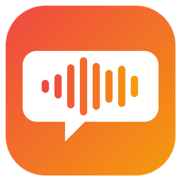
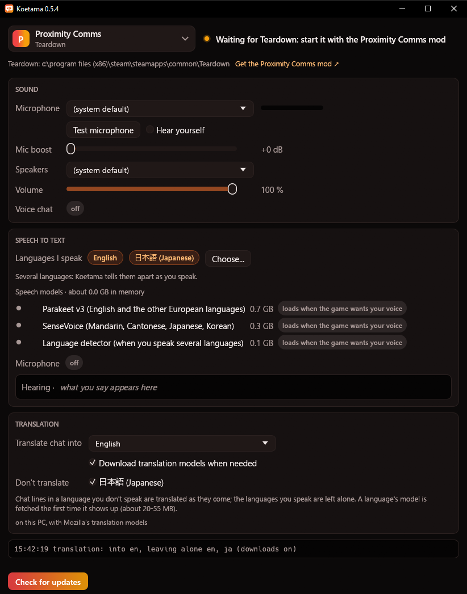
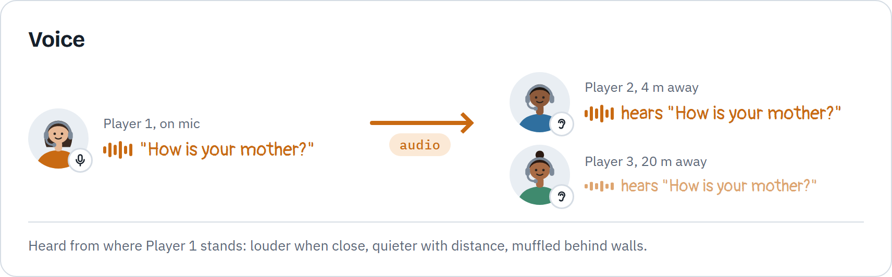
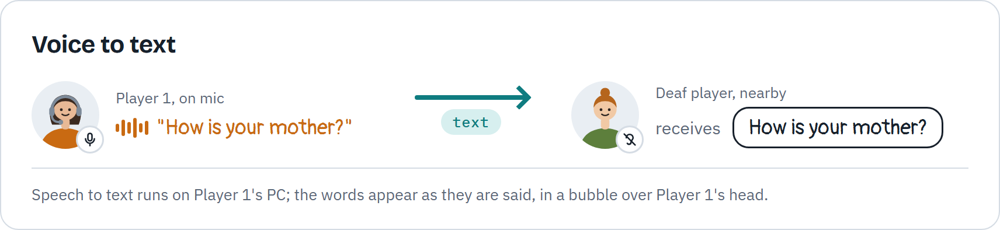
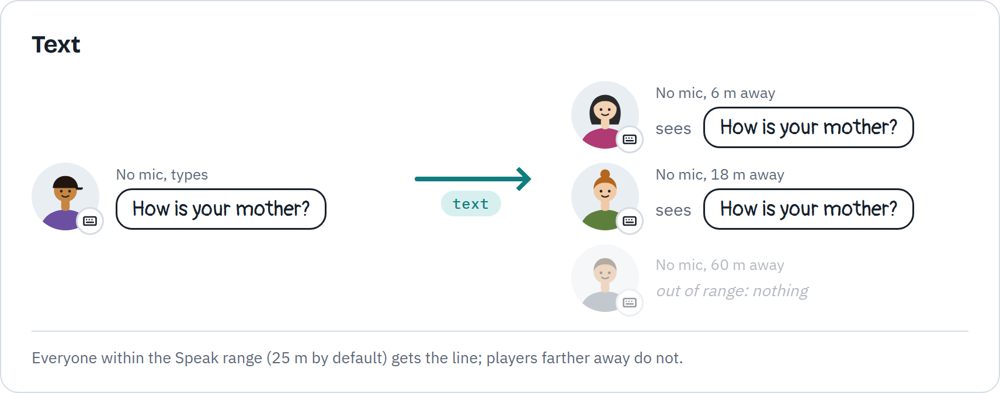
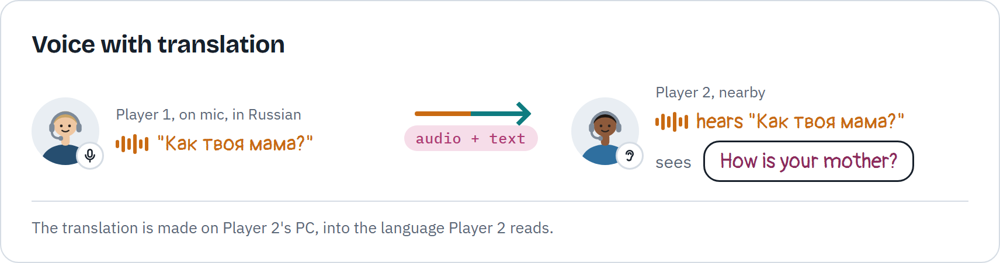
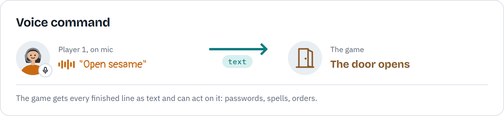

<p align="center">
  
</p>

<h1 align="center">Koetama</h1>

<p align="center">
  <b>Proximity voice chat with live speech-to-text, for game mods.</b><br>
  Hear other players where they stand. Your words appear in the game as you say them.
</p>

<p align="center">
  <a href="https://github.com/AgeOfAlgorithms/koetama/releases/latest/download/Koetama-Setup.exe"></a>
  &nbsp;
  <a href="https://github.com/AgeOfAlgorithms/koetama/releases/latest/download/Koetama-linux.tar.gz"></a>
</p>

<p align="center">
  <a href="https://github.com/AgeOfAlgorithms/koetama/releases"></a>
  <a href="https://github.com/AgeOfAlgorithms/koetama/stargazers"></a>
  <a href="https://ko-fi.com/ageofalgorithms"></a>
</p>

<p align="center">
  <sub>Windows code signing: free code signing provided by <a href="https://about.signpath.io/">SignPath.io</a>, certificate
  by <a href="https://signpath.org/">SignPath Foundation</a> (being set up: current downloads are not signed yet, so
  Windows may warn on first install; see the <a href="#code-signing-policy">code signing policy</a>).</sub>
</p>

<p align="center">
  <a href="https://github.com/AgeOfAlgorithms/koetama/releases"></a>
  <a href="https://github.com/AgeOfAlgorithms/koetama/actions/workflows/build.yml"></a>
  
  <a href="LICENSE"></a>
</p>

<p align="center">
  
</p>

Koetama (声魂, "voice spirit" in Japanese) runs next to your game. It plays the other players' voices placed where they
stand: louder when close, muffled behind walls. It also writes what you say as you say it, so the
game can show your words in text to other players. By extension, your game or mod gains speech recognition capability, which easily lets you build speech-activated events in the game.

**What kind of communications are possible with Koetama?**

<p align="center">
<picture>
  <source media="(prefers-color-scheme: dark)" srcset="docs/comms/1-voice-dark.png">
  
</picture>
</p>

<p align="center">
<picture>
  <source media="(prefers-color-scheme: dark)" srcset="docs/comms/2-captions-dark.png">
  
</picture>
</p>

<p align="center">
<picture>
  <source media="(prefers-color-scheme: dark)" srcset="docs/comms/3-typed-dark.png">
  
</picture>
</p>

<p align="center">
<picture>
  <source media="(prefers-color-scheme: dark)" srcset="docs/comms/4-translation-dark.png">
  
</picture>
</p>

<p align="center">
<picture>
  <source media="(prefers-color-scheme: dark)" srcset="docs/comms/5-command-dark.png">
  
</picture>
</p>

**Speech to text runs on your own PC**, and no account is needed. Your voice reaches the other players through a
small relay server, end-to-end encrypted with a key only the players in your game session have: the relay passes on
bytes it cannot listen to, and only to the players close enough to hear you.

## Highlights

- **Real voice chat.** Hear the other players where they stand: the game sets each voice's volume, direction and
  muffling. Only the players in range get your voice.
- **For deaf and hard-of-hearing players.** Everyone who talks with Koetama is captioned live, so players who can't
  hear can follow every conversation, and players without a microphone can still talk with them.
- **Many languages.** 14 fully supported, 8 in beta, 7 experimental. Speak several and mix them in one line. Pick the
  language you read once in Koetama, and chat in other languages is translated on your own PC as it arrives, in every
  game.
- **Light on your PC.** Only the speech models for your languages load: about 0.9 GB of memory for one language, up
  to 1.5 GB for several. It runs on the CPU, below the game's priority, and stays idle while you are silent.
- **Any game with a mod.** Games connect through small profile files, not plugins: anyone can add one.

## Install

**Windows:** download [`Koetama-Setup.exe`](https://github.com/AgeOfAlgorithms/koetama/releases/latest/download/Koetama-Setup.exe)
(always the newest version; every version is on [Releases](https://github.com/AgeOfAlgorithms/koetama/releases)) and run it. It installs for
your user only, with no administrator rights. Then start Koetama, pick your game mod and start the game.

**Linux / Steam Deck:** download [`Koetama-linux.tar.gz`](https://github.com/AgeOfAlgorithms/koetama/releases/latest/download/Koetama-linux.tar.gz), unpack it and run `Koetama/Koetama`. Games
running through Proton are found inside their Proton folder.

The first time you speak, Koetama downloads the speech model for your language once, showing its progress:

| Model | Languages | Download |
|---|---|---|
| Parakeet v3 | English and the other European languages | 670 MB |
| GigaAM v3 | Russian | 225 MB |
| SenseVoice | Mandarin, Cantonese, Japanese, Korean | 240 MB |

**Updates:** the window's **Check for updates** installs a new version and restarts Koetama.

**Uninstalling** asks whether to remove the downloaded speech models and your settings too (`%LOCALAPPDATA%\Koetama`,
with their size). The answer is Yes unless you choose No to keep them for a later reinstall.

## Game mods

| Game | Mod | Uses |
|---|---|---|
| Teardown | [Proximity Comms](https://steamcommunity.com/sharedfiles/filedetails/?id=3812301496) | voices and speech to text |

**Adding a game:** a mod made for Koetama comes with a small profile file (`.json`). In the window, open the game
mod list and choose **Add game mod...**. Koetama shows what the profile reads, writes and listens on before adding
it. A profile is not a program: it only points Koetama's built-in connectors at a game's files or at a local port,
and it can ask for voices, speech to text, or both.

**Making a mod for Koetama:** see [PROTOCOL.md](PROTOCOL.md) for the profile format and the two connectors (files,
or a local socket), with an example profile and test client in [`examples/`](examples/).

## Languages

Open **Languages I speak → Choose...** and tick every language you speak. Fewer languages are lighter and more
accurate. With several, Koetama tells them apart as you speak, choosing only among yours. Until you choose, it
follows the game's own language setting.

| Support | Languages |
|---|---|
| **Fully supported** | English, Spanish, French, German, Italian, Portuguese, Dutch, Polish, Ukrainian, Russian, Mandarin, Cantonese, Japanese, Korean |
| **Beta** (less accurate) | Czech, Slovak, Romanian, Croatian, Bulgarian, Finnish, Swedish, Hungarian |
| **Experimental** (many words come out wrong) | Danish, Estonian, Latvian, Lithuanian, Slovenian, Greek, Maltese |

## How it works

| Part | How |
|---|---|
| Voices | Your voice is compressed (Opus, 24 kbit/s), encrypted (ChaCha20-Poly1305) and sent through the relay, a Cloudflare Worker ([`relay/`](relay/)), to the players in range. The game sends each speaker's volume, direction and muffle; Koetama mixes them in stereo, low-passed behind walls. |
| Speech detection | Silero VAD v5 finds where a line starts and ends. |
| Speech to text | The line so far is transcribed again every second; only words two passes agree on are shown. One more pass when you stop gives the finished line. |
| Language detection | SpeechBrain's VoxLingua107 detector splits a mixed-language line into stretches, each written by its language's model. |
| Engine | [sherpa-onnx](https://github.com/k2-fsa/sherpa-onnx) and ONNX Runtime, on the CPU. |

## For developers

Koetama is a Rust program in [`app/`](app/), split into small crates ([`app/DESIGN.md`](app/DESIGN.md)). It needs
stable Rust, and on Windows the MSVC build tools.

```sh
cd app
cargo run -p koetama                     # the window
cargo run -p koetama -- --cli --help     # the command line, with test modes (no microphone needed)
cargo test --workspace                    # every part against the Python reference's answers
python build.py                           # dist/Koetama/ and, with Inno Setup 6, the Windows installer
```

- The language detector is built once with `python engine/export_lid.py` (torch, speechbrain and onnx).
- The first version was Python ([`engine/`](engine/)). It stays as the reference the Rust tests compare against, and
  [`bench/`](bench/) holds the benchmarks behind every model choice.
- `Koetama --selftest` checks a build's native parts. CI runs it on every build, and on Windows also installs,
  tests and uninstalls the installer.
- **Microphones and the voice chat** are tested without hardware: `cargo test -p kd-audio -p kd-voice` runs every
  kind of microphone (simulated: channels, polarity, level, rate, sample type) through Koetama's capture and through
  the voice chat between players on one machine; CI runs them on every pull request. `python tools/voice_e2e.py`
  goes further: two real Koetamas as players of a fake game, a stand-in relay, a simulated microphone saying a
  recording, and how loud and how understandable the other player hears it.

## Privacy

Speech to text runs on your PC, and Koetama has no accounts or telemetry. Your voice goes to the other players
end-to-end encrypted through the voice relay; models and updates come from Hugging Face and GitHub. Details:
[PRIVACY.md](PRIVACY.md).

## Code signing policy

Free code signing provided by [SignPath.io](https://about.signpath.io/), certificate by
[SignPath Foundation](https://signpath.org/).

- **What is signed:** the Windows program (`Koetama.exe`) and its installer (`Koetama-Setup.exe`), built by
  [GitHub Actions](.github/workflows/build.yml) from this repository's source for each release. Nothing built
  elsewhere is signed.
- **Team:** committers and reviewers: [AgeOfAlgorithms](https://github.com/AgeOfAlgorithms); approvers (each signing
  request is approved by hand): [AgeOfAlgorithms](https://github.com/AgeOfAlgorithms).
- **Privacy:** see [PRIVACY.md](PRIVACY.md). Koetama sends nothing to its author; it only connects to the services
  listed there, for the features you use.

## Support

Koetama is free and stays free. If it makes your games better, you can
[buy me a coffee on Ko-fi](https://ko-fi.com/ageofalgorithms). Stars, bug reports and game mods help too.

## License

MIT, see [LICENSE](LICENSE). The models and libraries Koetama uses are listed with their licenses in
[THIRD_PARTY_NOTICES.txt](THIRD_PARTY_NOTICES.txt).

## What's new

The three newest versions; every older one is in [CHANGELOG.md](CHANGELOG.md).

### 0.5.11: language model fixes

- **A model's short name finds its price:** "deepseek-flash" at DeepSeek's address is now priced as DeepSeek's newest
  Flash model. Before, it counted at the $3 / $15 fallback, so the budget ran out about 30 times too early.
- **A new model starts clean:** switching the API, address, model or key clears the last model's error from the
  status.
- **Long errors wrap:** the status says "failed", and the reason shows in full underneath.
- **Clearer price row:** Koetama only reads prices from OpenRouter's public list. Your requests go to the address you
  set, with your key.

### 0.5.10: game characters that talk

- **Large language models for game mods.** A host can let a game mod use a large language model, so its characters
  (or anything else the mod wants, like a director that plans the next wave) answer what players say, by voice or
  typed, and act in the game through functions the mod checks. Open the new **Large Language Models** card, pick the
  API (OpenAI-compatible, which covers OpenAI, DeepSeek, OpenRouter and others, or Anthropic), the model and your key,
  set a monthly budget, and tick "Let the ... mod use my language model". It's off unless you turn it on, for each
  game, and only the host needs it. **Try it** sends the model a message and shows the answer.
- **Your key stays on your PC,** sealed by Windows, and goes only to the API you chose. What a mod sends goes to that
  service with your key and costs you: Koetama counts the cost with OpenRouter's public price list and stops at your
  budget.
- **Updates are checked at start, and you see it:** "You have the latest version." (or the update) shows by itself, so
  there's no need to click.
- **For mod makers:** agents, their lines, function calls and replies (streamed word by word if you like) are in
  PROTOCOL.md, "Large language models: agents", with a how-to in docs/agents-guide.md.

### 0.5.9: louder voices

- **Voices are louder.** Players heard each other too quietly next to a game. Koetama now evens every microphone out
  to a louder level (-14 dBFS, was -20), and a voice right in front of you is no longer played 3 dB under its level:
  about 6 dB louder in all.
- **Quiet microphones are raised all the way** (up to +40 dB, was +30). A very quiet microphone's speech used to be
  taken for silence and not raised at all. If yours is that quiet, the window now says so and where to turn it up.
- **Mic boost does what it says:** it now makes your voice louder than everyone else's (up to +10 dB). Before, it came
  before the automatic gain, which mostly took it back.
- **The microphone test sounds like the real thing:** it no longer raises the noise in your room between words.
- **For developers:** `tools/mic_levels.py` and `cargo run -p kd-voice --example mic_check` measure a real
  microphone's levels; a very quiet simulated microphone (`--sim-mic very-quiet`) is in the tests.
